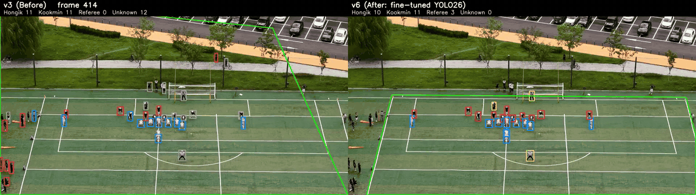
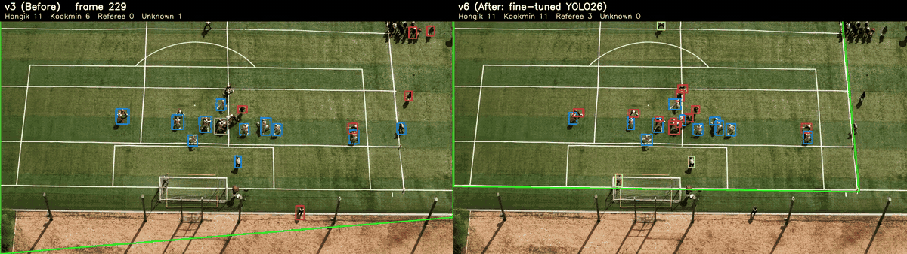
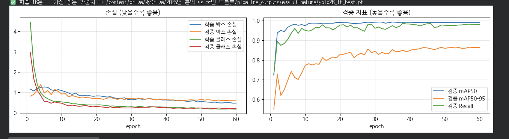

# 드론 미식축구 영상 분석: 선수·심판 탐지, 추적, 팀 분류

드론으로 촬영한 대학 미식축구 경기(홍익대 vs 국민대) 영상에서 **경기장 안의 선수와 심판을 찾고, 같은 사람을 계속 추적하고, 홍익 / 국민대 / 심판으로 구분**하는 컴퓨터 비전 파이프라인입니다.

컴퓨터 비전 이론을 모르는 상태에서 만들었던 첫 버전(v3)을, 이론을 공부하면서 단계별로 고치고 **매번 같은 평가셋으로 측정해** 개선한 기록입니다.



왼쪽 v3(Before), 오른쪽 v6(최종). 파랑 = 홍익, 빨강 = 국민대, 노랑 = 심판, 회색 = 미분류, 초록 선 = 경기장 경계(ROI).
v3는 주차장·골대 뒤 사람까지 선수로 잡고 심판을 구분하지 못하지만, v6은 경기장 안만 보고 심판 3명을 구분합니다.
원본 영상: [videos/0144_v3_vs_v6.mp4](videos/0144_v3_vs_v6.mp4) · [videos/0156_v3_vs_v6.mp4](videos/0156_v3_vs_v6.mp4)

## 실험의 두 질문

1. 컴퓨터가 드론 영상에서 **홍익 선수 · 국민대 선수 · 심판**을 확실하게 구분할 수 있는가?
2. 컴퓨터가 **경기장 경계**를 인지해서 경기장 밖 사람(벤치, 코치, 관중)을 빼고 볼 수 있는가?

## 결과 요약

평가셋: 득점 플레이 2개에서 뽑은 프레임 20장, 직접 라벨링한 정답 박스 487개

| | v3 (Before) | v5 | **v6 (최종)** |
|---|---|---|---|
| 탐지 F1 | 0.664 | 0.929 | **0.957** |
| Recall | 0.671 | 0.899 | **0.969** |
| 오탐 (FP) | 171 | 18 | 27 |
| 놓친 선수 (FN) | 160 | 49 | **15** |
| 팀 분류 정확도 | 0.709 | 0.904 | **0.922** |
| 심판 Recall | 0 | 0.81 | **1.00** |

- **v5**: 사전학습 YOLO26x + ByteTrack 튜닝 + PyTorch ResNet18 팀 분류기 + 자동 ROI
- **v6**: 직접 구축한 데이터로 파인튜닝한 YOLO26m 하나로 탐지와 팀 분류를 함께 수행 (사전학습 x 모델보다 2배 이상 빠름)

## 파이프라인

```
드론 영상
  → ① 경기장 경계(ROI): 참조 프레임 + SIFT 특징 매칭 + RANSAC 호모그래피로 자동 계산, 30프레임마다 갱신
  → ② 선수 탐지: YOLO26 (1920 원본 해상도 입력)
  → ③ 추적: ByteTrack (칼만 필터 + 두 단계 짝짓기)
  → ④ 팀·심판 분류: ResNet18 (v5) 또는 파인튜닝 YOLO 클래스 (v6)
  → 프레임별 선수 위치·ID·팀 JSON + 확인용 영상
```

## 단계별 개선

| 단계 | 문제 / 가설 | 한 일 | 결과 |
|---|---|---|---|
| ROI 재설정 | 오탐 대부분이 경기장 밖 사람 | OpenCV HSV 마스크로 흰 라인 검출, 형태학 연산(팽창), 발 위치로 안/밖 판단 | 오탐 171 → 3, 잃은 정답 0 |
| 탐지기 비교 | 놓친 선수는 작거나 겹친 선수 | YOLOv8x vs YOLO26x, 입력 960/1280/1920, SAHI 비교 | 해상도 효과 > 모델 효과. Recall 0.671 → 0.850 |
| 추적기 튜닝 | 탐지한 선수의 11%를 추적에서 잃음 | ByteTrack 설정 55개를 정답 없는 대체 지표와 사전에 정한 규칙으로 비교 | 추적 손실 11% → 0.4% |
| 인원 규칙 점검 | “팀당 11명, 심판 3명” 후처리 규칙 | 규칙만 켜고 끄는 비교 | 규칙이 오히려 정답을 지움. 원인은 분류기 편향 |
| 팀 분류기 교체 | 색 히스토그램 + 랜덤포레스트가 홍익으로 쏠림 | PyTorch ResNet18 전이 학습 (트랙 단위 라벨링·분할, 클래스 가중 손실) | 팀 정확도 0.731 → 0.904, 심판 0 → 0.81 |
| 자동 ROI | 클립마다 경계를 사람이 지정 | SIFT + RANSAC 호모그래피로 참조 경계를 옮김 | 직접 지정과 동일 성능 |
| 드론 움직임 대응 | 긴 클립에서 사이드라인 인원 혼입 (국민대 15~16명) | ROI를 30프레임마다 재계산 | 프레임당 국민대 15.3 → 11.4명 |
| YOLO 파인튜닝 | 남은 놓침은 엉킨 무리의 작은 선수 | 학습용 40장(박스 994개) 직접 라벨링, 경기장 밖 가림, 640 조각 학습 → YOLO26m 3클래스 파인튜닝 | 작은 선수 Recall 0.31 → 0.75, FN 49 → 15 |



클립 0156: v3는 경기장 경계가 사실상 화면 전체라 오른쪽 위 벤치 무리와 펜스 밖 사람까지 잡습니다. v6은 경계 안만 보고, 엉킨 무리 안의 선수를 더 많이 찾습니다.



자세한 수치와 해석은 [docs/experiment_log.md](docs/experiment_log.md)에 있습니다.

## 평가 설계

- **정답 데이터 직접 구축**: Roboflow에서 모델 초안을 사람이 수정 (평가 20장, 학습 40장)
- **데이터 누수 방지**: 평가 클립(0144, 0156)은 채점에만, 튜닝 클립(0143, 0157)은 설정 선택·학습에만 사용. 분류기는 트랙 단위로 학습/검증 분할
- **작은 객체 매칭**: 선수가 10~25px로 작아 IoU 대신 박스 중심 거리 + 헝가리안 알고리즘으로 정답과 예측을 짝지음
- **지표**: Precision / Recall / F1, 팀 정확도, 클래스별·크기별 Recall

## 노트북

Google Colab(T4 GPU)과 Google Drive 기준으로 작성했습니다. 위에서부터 순서대로 실행합니다.

| 노트북 | 내용 |
|---|---|
| `00_eval_set_and_v3_baseline` | 평가용 정답 데이터 만들기, v3 기준 점수 측정 |
| `01a_roi_opencv` | OpenCV로 경기장 경계(ROI) 재설정 |
| `01b_detector_comparison` | YOLO 모델 · 입력 해상도 · SAHI 비교 |
| `02a_bytetrack_tuning` | ByteTrack 설정 탐색 (튜닝 클립, 정답 없는 지표) |
| `02b_v4_integration` | 탐지 + 추적 통합 (v4) |
| `03a_rule_check` | 인원 후처리 규칙 점검 |
| `03b_team_classifier_resnet18` | PyTorch ResNet18 팀 분류기 학습 (v5) |
| `04a_auto_roi_homography` | SIFT + RANSAC 호모그래피 자동 ROI 검증 |
| `05a_finetune_data` | YOLO 파인튜닝용 학습 데이터 초안 만들기 |
| `05b_yolo26_finetune` | YOLO26 파인튜닝과 평가 (v6) |
| `run_pipeline` | 영상 → JSON + 확인용 영상 실행 노트북 |

## 사용 기술

- **OpenCV**: HSV 색 공간 마스크, 형태학 연산, 윤곽선·다각형 처리, SIFT 특징 매칭, RANSAC 호모그래피, 영상 입출력과 시각화
- **YOLO (Ultralytics YOLOv8 / YOLO26)**: 모델·해상도 비교, conf와 NMS, 640 조각 학습 + 1920 전체 추론 파인튜닝
- **PyTorch**: ResNet18 전이 학습 (Dataset/DataLoader, 증강, 클래스 가중 CrossEntropy, AdamW + Cosine)
- **추적**: ByteTrack (numpy 구현, 칼만 필터, 헝가리안 매칭)
- **라벨링**: Roboflow

## 데이터와 한계

- 원본 영상, 라벨 데이터, 학습된 가중치는 용량과 촬영된 사람들의 초상권 때문에 포함하지 않았습니다.
- 평가셋이 20장(선수 438명)으로 작아서 0.01~0.02 차이는 우연일 수 있습니다.
- 학습과 평가는 같은 경기의 서로 다른 장면입니다. 다른 경기나 다른 유니폼에서의 성능은 확인하지 않았습니다.
- 코드는 AI 도구를 활용해 작성했고, 실험 설계·데이터 라벨링·결과 분석과 검증은 직접 수행했습니다.

## 다음 단계

- 팀 라벨을 트랙 전체 다수결 대신 박스별·구간별로 정하기 (추적 ID가 다른 팀 선수로 넘어갈 때 생기는 오분류 감소)
- ROI 갱신이 직전과 크게 다르면 버리는 안정성 검사
- 필드 키포인트(YOLO-Pose) + 경기장 도면 호모그래피로 선수 위치를 야드 단위로 계산
